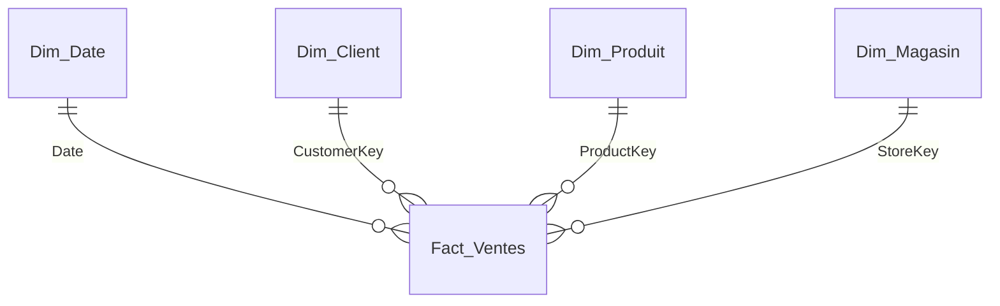

# Patterns de modélisation

## Dimensions de rôle

Une seule `Dim_Date`, plusieurs relations vers le fait ; une seule active.

```
Dim_Date[Date] 1 ──→ * Fact_Ventes[DateCommande]   (active)
Dim_Date[Date] 1 ··→ * Fact_Ventes[DateLivraison]  (inactive)
```

```dax
CA HT par date de livraison =
CALCULATE (
    [CA HT],
    USERELATIONSHIP ( Dim_Date[Date], Fact_Ventes[DateLivraison] )
)
```

Si les utilisateurs doivent filtrer sur les deux dates simultanément dans un même visuel, créer une copie `Dim_Date Livraison` (table calculée ou requête Power Query) plutôt que multiplier les mesures.

## SCD

- **Type 1** : on écrase l'attribut ; pas d'historique. Par défaut.
- **Type 2** : nouvelle ligne à chaque changement.

| CustomerKey | CustomerCode | Region | DateDebut | DateFin | EstCourant |
|---|---|---|---|---|---|
| 101 | C-0042 | Nord | 2024-01-01 | 2025-06-30 | Faux |
| 245 | C-0042 | Ouest | 2025-07-01 | 9999-12-31 | Vrai |

Le fait référence la `CustomerKey` valide à la date de l'événement (résolu en amont, dans l'ETL). Compter les clients avec `DISTINCTCOUNT ( Dim_Client[CustomerCode] )`, pas la clé de substitution.

## Plusieurs-à-plusieurs

Préférer une **table pont** à une relation `*:*` native :

```
Dim_Client 1 → * Bridge_ClientCompte * ← 1 Dim_Compte 1 → * Fact_Soldes
```

- La relation `Dim_Client → Bridge` doit propager le filtre vers `Dim_Compte` : soit relation bidirectionnelle **limitée à ce segment**, soit filtrage explicite dans la mesure :

```dax
Solde clients =
CALCULATE (
    [Solde],
    CROSSFILTER ( Bridge_ClientCompte[CompteKey], Dim_Compte[CompteKey], BOTH )
)
```

- Les totaux ne sont pas additifs (un compte partagé est compté une fois au total) : le documenter dans la description de la mesure.

## Grains différents

Budget au mois, ventes au jour : relier `Fact_Budget` à une dimension au grain mois (ou à `Dim_Date` via une colonne `PremierJourMois` en relation sur la date du 1er du mois) et ne jamais afficher le budget au niveau jour sans règle de répartition explicite.

## En-tête / détail

Aplatir : porter les attributs de l'en-tête (client, canal, date) sur chaque ligne de détail. Les montants d'en-tête (frais de port) sont soit répartis au prorata des lignes, soit stockés dans une table de faits séparée au grain commande.

## Dimensions junk et dégénérées

- **Dégénérée** : numéro de facture laissé dans le fait (pas de dimension dédiée).
- **Junk** : regrouper des flags à faible cardinalité (`EstPromo`, `CanalWeb`, `ModePaiement`) dans une `Dim_Profil` avec une clé, plutôt que les laisser comme colonnes texte dans un gros fait.

## Diagramme Mermaid type


